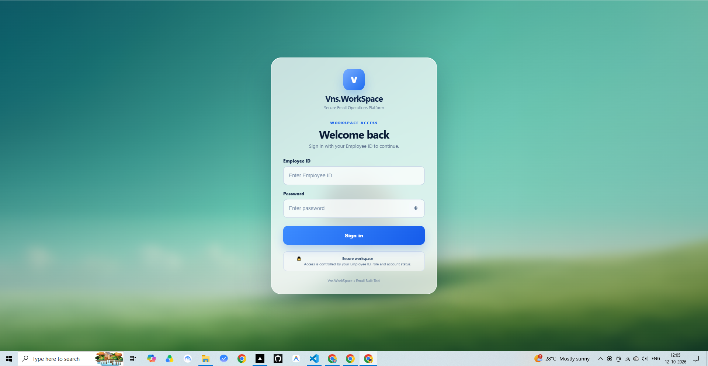
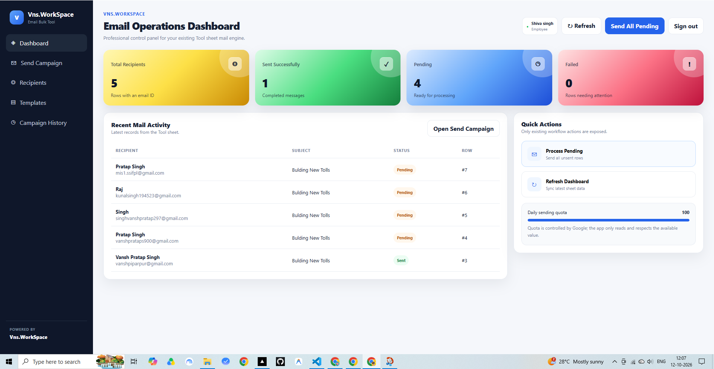
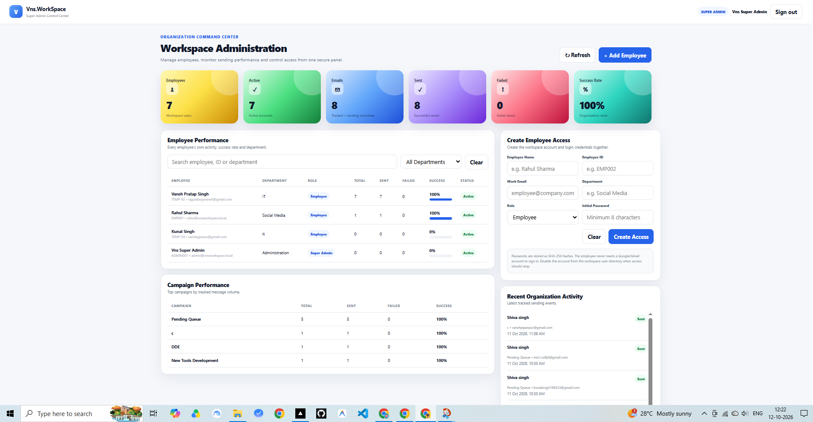
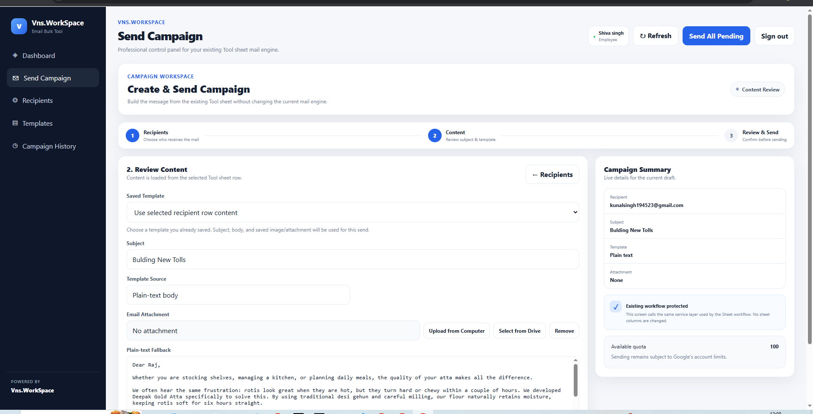
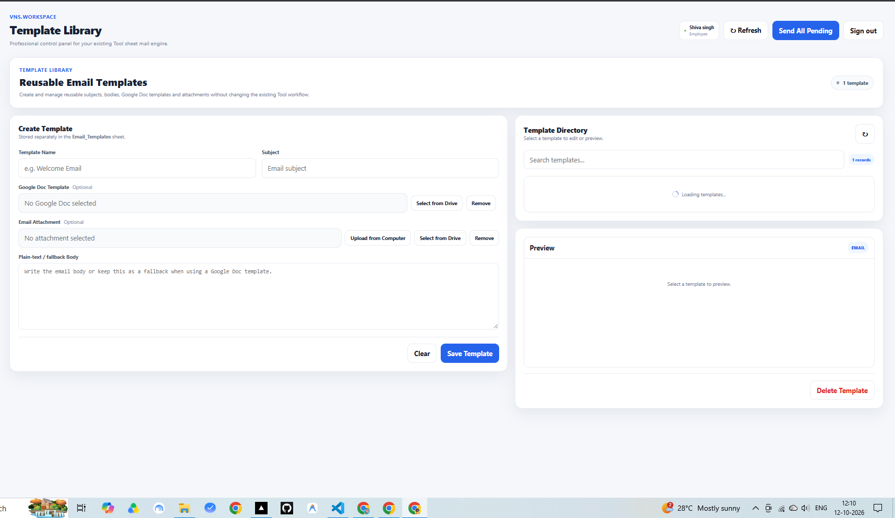

# Vns.WorkSpace — Email Campaign Automation

A web-based email campaign management tool built with Google Apps Script, Google Sheets, Gmail services, and HTML/CSS/JavaScript. Vns.WorkSpace brings recipient selection, email composition, attachment handling, and campaign tracking into one interface.

## Project Preview
## Project Preview

### Login Page

### Main Dashboard

### Admin Dashboard

### Send Campaign

### Template Library

## Live Demo

**[View Live Demo](https://script.google.com/macros/s/AKfycbxy1SJvL3Wj5OGXEwc-1hxdFUiXV2GcgfM2wLwA5lVkEJeBsy1yJVNNq10aAOb_L_zW/exec)**

Open the application login page to get a first look at Vns.WorkSpace.

> The live demo's availability and functionality depend on the current deployment configuration. Please do not enter sensitive or real customer information.

## Overview

Managing email campaigns manually can involve repetitive work across recipient lists, email content, attachments, and campaign records.

Vns.WorkSpace aims to make this workflow more organized by bringing key email campaign tasks together in a centralized web interface. It uses Google Apps Script to connect the application with Google services and Google Sheets for relevant data and campaign records.

## The Problem

Manual email campaign workflows can involve several repetitive tasks:

- Managing recipient lists and selecting recipients.
- Preparing and reusing email content.
- Handling attachments for outgoing messages.
- Tracking sent and failed messages.
- Reviewing previous campaign activity.
- Monitoring campaign-related information across different records.

Handling these tasks separately can make the workflow harder to organize and review.

## Project Objectives

The main objectives of Vns.WorkSpace are to:

- Provide a centralized interface for email campaign management.
- Simplify recipient selection and email composition.
- Support reusable email templates.
- Include attachment handling in the campaign workflow.
- Maintain campaign activity records for review.
- Display key campaign statistics in a dashboard.
- Reduce repetitive work through Google Apps Script automation.

## Key Features

### 1. Email Campaign Management
Manage email campaigns through a web-based interface.

### 2. Recipient Selection
Work with available recipient data and select recipients for a campaign.

### 3. Reusable Email Templates
Use reusable email content to make recurring communication easier to prepare.

### 4. Attachment Support
Include relevant files in email campaigns where supported by the configured workflow.

### 5. Campaign History
Review recorded campaign activity and message-related information.

### 6. Dashboard and KPIs
View campaign-related statistics, such as campaigns, sent messages, failed messages, and logged messages where available.

### 7. Sender Display Name
Configure the sender display name for outgoing emails where supported by the application and Google account permissions.

### 8. Google Sheets Integration
Use Google Sheets as a data source for relevant application records and campaign information.

### 9. Web-Based Interface
Access the application's interface through HTML, CSS, and JavaScript, powered by Google Apps Script.

## How It Works

The application connects the web interface with Google Apps Script, Google Sheets, and Gmail services.

1. The user opens the web application and signs in.
2. Available recipient data is used to prepare a campaign.
3. The user selects recipients and prepares the email content.
4. Templates and attachments can be used as supported by the workflow.
5. Google Apps Script processes relevant operations using the configured Google services.
6. Campaign and message activity can be reviewed through available records and dashboard metrics.

The exact workflow depends on the source code, spreadsheet structure, deployment settings, and Google account permissions.

## Technology Stack

| Technology | Purpose |
|---|---|
| Google Apps Script | Application logic and Google services integration |
| Google Sheets | Data storage and campaign records |
| Gmail services | Email delivery |
| Google Drive services | File access and attachment handling where configured |
| HTML | Web interface structure |
| CSS | Layout and styling |
| JavaScript | Client-side interactions and interface behavior |

## Business Value

Vns.WorkSpace is designed to make recurring email operations easier to organize and monitor.

- **Less repetitive work:** Brings common campaign tasks into one interface.
- **Centralized workflow:** Keeps recipient selection, message preparation, and campaign tracking together.
- **Reusable communication:** Templates can reduce the effort required to prepare recurring messages.
- **Improved visibility:** Dashboard metrics and campaign history help users review activity.
- **Simpler record review:** Google Sheets provides a familiar way to manage relevant records.
- **Potential time savings:** Automating repetitive steps may reduce manual effort, depending on the workflow and campaign volume.

Actual results depend on usage and application configuration.

## Setup and Configuration

Vns.WorkSpace uses Google Apps Script and Google Sheets. To configure your own instance, you need access to a Google account and the project source code.

### Prerequisites

- A Google account.
- Access to Google Apps Script.
- A Google Spreadsheet configured for the application.
- Gmail access and the required permissions if email sending is enabled.
- The project source files.

### Setup Steps

1. **Create or open a Google Spreadsheet.**  
   Prepare the spreadsheet structure required by the application, including the sheet names and columns expected by the source code.

2. **Open Google Apps Script.**  
   Create a new Apps Script project or open an existing project.

3. **Add the project files.**  
   Copy the relevant server-side code and HTML files into the Apps Script project, preserving the filenames and references expected by the application.

4. **Configure spreadsheet access.**  
   Ensure the script references the correct spreadsheet and that the required sheets and columns exist.

5. **Review permissions.**  
   Check which Google services the application uses and grant only the permissions required for its intended functionality.

6. **Test the workflow.**  
   Start with controlled test data and authorized test recipients. Verify email content, attachments, and campaign records before using the application for real campaigns.

7. **Deploy the web application.**  
   In Apps Script, create a web app deployment and configure access according to your use case and security requirements.

8. **Review deployment settings.**  
   Confirm who can access the application, which account executes the script, and whether the settings are appropriate for its functionality.

> **Configuration note:** Spreadsheet IDs, sheet names, column names, and deployment settings must match the implementation. Refer to the source code for the configuration expected by the application.

## Testing Checklist

Use this checklist when validating a deployment. Mark an item complete only after confirming the behavior.

- [ ] Application opens successfully.
- [ ] Login works with the intended credentials.
- [ ] Recipient data loads correctly.
- [ ] Recipient selection behaves as expected.
- [ ] Email subject and body are handled correctly.
- [ ] Templates can be used as intended.
- [ ] Attachments are included and delivered correctly.
- [ ] Sender display name behaves as configured.
- [ ] Test emails reach the intended test recipients.
- [ ] Sent and failed message records are handled correctly.
- [ ] Campaign history displays the expected information.
- [ ] Dashboard metrics reflect the available records.
- [ ] Unauthorized access and unintended email sending are appropriately restricted.

## Security and Operational Notes

- Do not commit passwords, private tokens, API keys, or sensitive customer information to a public repository.
- Do not publish private demo credentials in the README.
- Restrict email sending to authorized users and appropriate recipients.
- Review Google Apps Script deployment access and execution settings before sharing the application.
- If the demo is intended only for viewing, disable email sending in the server-side code as well as the interface.
- Test with non-sensitive data and controlled recipients before sending campaign emails.
- Review Google account permissions and applicable sending limits before operational use.
- Avoid entering confidential or production data into a public demo.

## Limitations

- The application depends on Google Apps Script, Google Sheets, Gmail services, and their permissions.
- Available functionality depends on the configured spreadsheet structure and deployment settings.
- Email delivery can be affected by account permissions, service limits, recipient systems, and spam filtering.
- Dashboard statistics depend on the records and calculations maintained by the application.
- The live demo's availability and behavior depend on the current deployment configuration.

## Future Improvements

Potential improvements for future versions include:

- More detailed campaign reports and analytics.
- Additional validation for recipient lists and email content.
- Stronger access controls and safer demo-account management.
- More detailed error reporting and delivery diagnostics.
- Improved attachment validation and handling.
- Campaign scheduling and additional automation options.
- Expanded automated tests for important workflows.

These are potential future enhancements, not claims about existing functionality.

## What This Project Demonstrates

Vns.WorkSpace brings together web interface development, Google Apps Script automation, spreadsheet-based data management, and email workflow integration.

The project demonstrates how Google Workspace services can be used to organize repetitive business tasks in a centralized application, with a focus on usability, tracking, and operational visibility.

## Project Summary

**Vns.WorkSpace — Email Campaign Automation** is a Google Apps Script-based application designed to organize email campaign workflows by bringing recipient management, reusable content, attachment handling, and campaign tracking into one interface.

The goal is to reduce repetitive manual effort and make campaign activity easier to manage and review.

---

**Project:** Vns.WorkSpace  
**Category:** Email Automation · Workflow Management · Google Workspace  
**Built with:** Google Apps Script, Google Sheets, HTML, CSS, and JavaScript

**Repository:** [email-campaign-automation](https://github.com/vansh-sql/email-campaign-automation)
